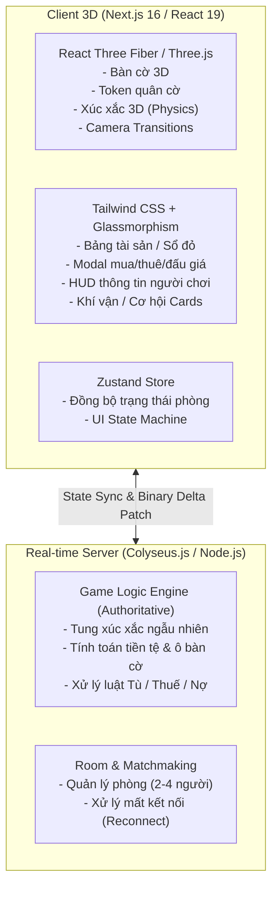

# 🎲 LỘ TRÌNH & CẤU TRÚC PHÁT TRIỂN GAME CỜ TỶ PHÚ 3D ONLINE (MONOPOLY 3D)

Tài liệu này là kim chỉ nam chi tiết từng giai đoạn phát triển game **Cờ Tỷ Phú 3D Real-Time** trên nền tảng Web với **Next.js (App Router), Three.js / React Three Fiber, Zustand, Tailwind CSS và Colyseus**.

---

## 🏗️ 1. KIẾN TRÚC TỔNG THỂ & TECH STACK



---

## 📂 2. CẤU TRÚC THƯ MỤC DỰ ÁN CHI TIẾT (PROJECT DIRECTORY STRUCTURE)

```text
monopoly-3d/
├── public/
│   ├── models/                 # Chứa các file 3D (.glb, .gltf: nhà, khách sạn, xúc xắc, token xe hơi)
│   ├── sounds/                 # Âm thanh game (.mp3: xúc xắc, bước chân, tiếng đếm tiền, còi tù)
│   └── textures/               # Ảnh họa tiết bàn cờ, logo, icon thẻ bài
│
├── src/
│   ├── types/                  # 📐 1. Định nghĩa Kiểu Dữ Liệu (Domain Contract)
│   │   ├── game.ts             # TileData, Player, GameState, TurnPhase, GameLog
│   │   ├── cards.ts            # Cấu trúc thẻ Cơ hội / Khí vận
│   │   └── colyseus.ts         # Type cho Room Schema khi kết nối online
│   │
│   ├── constants/              # 📋 2. Dữ liệu tĩnh & Cấu hình Bàn Cờ
│   │   ├── boardData.ts        # Danh sách 40 ô chuẩn VN (Tên, giá mua, tiền thuê từng cấp nhà)
│   │   ├── chanceCards.ts      # Danh sách thẻ Cơ hội (Thưởng/Phạt/Dời vị trí)
│   │   ├── communityChest.ts   # Danh sách thẻ Khí vận
│   │   └── gameConfig.ts       # Cấu hình: Tiền khởi đầu ($1500), tiền qua ô GO ($200), thời gian lượt (30s)
│   │
│   ├── utils/                  # 🧮 3. Hàm tính toán & Thuật toán
│   │   ├── boardCoordinates.ts # Tính tọa độ 3D (X, Y, Z) và góc xoay của 40 ô
│   │   ├── dicePhysics.ts      # Tính toán góc quay xúc xắc theo kết quả ngẫu nhiên
│   │   └── formatters.ts       # Format tiền tệ (vd: 1.500k, 200M), format thời gian
│   │
│   ├── store/                  # 🧠 4. Quản lý State & Game Engine (Zustand)
│   │   ├── gameStore.ts        # State chính: lượt chơi, danh sách người chơi, trạng thái 40 ô
│   │   ├── uiStore.ts          # State giao diện: modal đang mở, camera focus vào ai
│   │   └── soundStore.ts       # Quản lý bật/tắt âm thanh, âm lượng
│   │
│   ├── components/             # 🎨 5. Toàn bộ Component hiển thị (Chia làm 2 thế giới)
│   │   │
│   │   ├── 3d/                 # 🌌 THẾ GIỚI 3D (Three.js / React Three Fiber)
│   │   │   ├── Scene.tsx       # Khung Canvas 3D chính, ánh sáng, đổ bóng, môi trường
│   │   │   ├── CameraController.tsx # Điều khiển góc camera (toàn cảnh / zoom vào người chơi)
│   │   │   ├── Board3D.tsx     # Dựng bàn cờ 3D từ 40 ô
│   │   │   ├── Tile3D.tsx      # Từng khối ô 3D (màu sắc, tên ô, nhà/khách sạn trên ô)
│   │   │   ├── Token3D.tsx     # Quân cờ 3D với animation nhảy từng ô (GSAP)
│   │   │   ├── Dice3D.tsx      # Cặp xúc xắc 3D xoay lăn trên bàn
│   │   │   └── HouseBuilding3D.tsx # Mô hình nhà / khách sạn mọc lên khi mua
│   │   │
│   │   └── ui/                 # 📱 THẾ GIỚI 2D (Giao diện DOM đè lên Canvas 3D)
│   │       ├── hud/            # Thanh hiển thị thông tin
│   │       │   ├── PlayerHUD.tsx      # Danh thiếp người chơi, tiền mặt, avatar
│   │       │   ├── TurnIndicator.tsx  # Thông báo lượt ai, đồng hồ đếm ngược
│   │       │   └── ActionControls.tsx # Nút "Đổ xúc xắc", "Mua nhà", "Kết thúc lượt"
│   │       │
│   │       ├── modals/         # Các bảng hộp thoại tương tác
│   │       │   ├── BuyPropertyModal.tsx   # Hộp thoại hỏi mua đất
│   │       │   ├── RentPaidModal.tsx      # Thông báo vừa bị trừ tiền thuê
│   │       │   ├── CardDrawModal.tsx      # Hiệu ứng lật thẻ Cơ Hội / Khí Vận
│   │       │   ├── PropertyDetailModal.tsx# Xem chi tiết "Sổ đỏ" của 1 ô đất
│   │       │   └── TradeModal.tsx         # Bảng đàm phán giao dịch giữa 2 người
│   │       │
│   │       └── common/         # Button, Badge, Modal Wrapper, Tooltip
│   │
│   ├── hooks/                  # 🪝 6. Custom React Hooks
│   │   ├── useSoundEffects.ts  # Kích hoạt âm thanh (xúc xắc, bước chân, tiền reo)
│   │   ├── usePawnMovement.ts  # Hook điều phối animation nhảy ô từng bước
│   │   └── useColyseusRoom.ts  # Hook kết nối phòng Multiplayer online
│   │
│   └── app/                    # 🌐 7. Next.js App Router (Trang Web)
│       ├── page.tsx            # Trang Game chính (Ghép Scene 3D + UI HUD)
│       ├── lobby/page.tsx      # (Giai đoạn sau) Sảnh tạo phòng / vào phòng online
│       ├── layout.tsx          # Font chữ, Meta tags SEO, Sound Provider
│       └── globals.css         # Tailwind CSS + custom glassmorphism styles
```

---

## 🗺️ 3. LỘ TRÌNH 7 GIAI ĐOẠN (STEP-BY-STEP ROADMAP)

### 📌 GIAI ĐOẠN 1: Khởi tạo Project & Cấu trúc Thư mục
- [x] Khởi tạo dự án Next.js (TypeScript, Tailwind CSS, App Router).
- [x] Cài đặt các thư viện 3D cốt lõi:
  - `three`, `@types/three`
  - `@react-three/fiber`, `@react-three/drei`
  - `zustand` (quản lý state)
  - `gsap` (hiệu ứng di chuyển mượt mà)
  - `howler`, `@types/howler` (âm thanh game)
  - `colyseus.js` (kết nối game server)
  - `lucide-react`, `canvas-confetti`, `@types/canvas-confetti`
- [ ] Thiết lập thư viện Types/Interfaces chung: `TileData`, `PlayerState`, `GameState`, `SocketEvents`.

---

### 📌 GIAI ĐOẠN 2: Core Data & Thiết kế 40 Ô Bàn Cờ
- [ ] Định nghĩa danh sách 40 ô bàn cờ chuẩn phong cách Việt Nam (hoặc quốc tế):
  - 22 ô đất (chia làm 8 khu màu: Nâu, Xanh nhạt, Hồng, Cam, Đỏ, Vàng, Xanh lá, Xanh dương).
  - 4 ô Bến xe / Sân bay / Ga tàu.
  - 2 ô Tiện ích (Điện lực, Cấp nước).
  - 4 ô Góc: Khởi Hành (GO), Đi Tù (Jail/Just Visiting), Bãi Đỗ Xe (Free Parking), Vào Tù (Go To Jail).
  - 3 ô Khí Vận, 3 ô Cơ Hội, 2 ô Thuế.
- [ ] Xây dựng thuật toán tính toán tọa độ 3D $(X, Y, Z)$ cho 40 ô tạo thành bàn cờ vuông đối xứng.

---

### 📌 GIAI ĐOẠN 3: Dựng Bàn Cờ 3D & Chuyển Động Quân Cờ
- [ ] **Bàn cờ 3D (Procedural Board):**
  - Render 40 khối 3D với màu sắc tương ứng từng nhóm đất.
  - Đèn chiếu sáng (Directional Light, Ambient Light, Shadows).
  - Khối trung tâm (Logo game, khay đổ xúc xắc 3D).
- [ ] **Quân cờ 3D (Tokens):**
  - Mô hình token 3D (Pawn/Linh vật/Xe hơi).
  - Xử lý vị trí khi nhiều người chơi cùng đứng chung 1 ô (tránh đè lên nhau).
- [ ] **Animation di chuyển (Jump/Hop):**
  - Hiệu ứng quân cờ nhảy từng bước (Arc Jump) theo số bước xúc xắc.
  - Camera tự động lia nhẹ theo quân cờ đang di chuyển.

---

### 📌 GIAI ĐOẠN 4: Đổ Xúc Xắc 3D (3D Dice System)
- [ ] Render 2 viên xúc xắc 3D với hiệu ứng quay và dừng đúng mặt kết quả.
- [ ] Đồng bộ kết quả xúc xắc: Server sinh số ngẫu nhiên $[1..6] + [1..6]$ $\rightarrow$ Client ném xúc xắc dừng ở đúng mặt kết quả.
- [ ] Xử lý luật "Đổ đôi": Đổ 2 mặt giống nhau được đi tiếp, đổ 3 lần đôi liên tiếp bị Vào Tù.

---

### 📌 GIAI ĐOẠN 5: Game Loop & Giao Diện 2D Overlay (HUD)
- [ ] **HUD Người chơi:**
  - Danh thiếp người chơi: Avatar, Tên, Số tiền mặt, Tổng tài sản.
  - Hiển thị lượt hiện tại & đếm ngược thời gian (Turn Timer 30s).
- [ ] **Modals tương tác:**
  - Modal mua đất / Xây nhà (1-4 nhà, 1 khách sạn).
  - Modal thông báo trả tiền thuê khi dẫm vào đất đối thủ.
  - Modal lật thẻ Khí Vận / Cơ Hội với animation xoay 3D.
  - Modal đàm phán / Giao dịch (Trade) giữa 2 người chơi.
  - Modal Phá sản & Bán đấu giá tài sản.
- [ ] **Nhà & Khách sạn 3D:**
  - Hiển thị mô hình nhà nhỏ (màu xanh lá) và khách sạn (màu đỏ) mọc lên trên các ô đất khi người chơi nâng cấp.

---

### 📌 GIAI ĐOẠN 6: Multiplayer Backend (Colyseus Game Server)
- [ ] Tạo Game Server (Node.js Colyseus):
  - Quản lý danh sách phòng (Lobby / Create Room / Join via Room Code).
  - Tối đa 2 - 4 người chơi mỗi phòng.
  - Nút "Sẵn sàng" và Bắt đầu trận.
- [ ] Authoritative Game State Engine:
  - Server xác thực mọi hành động (chống hack tiền/vị trí).
  - State Synchronization tự động cập nhật mọi client.
- [ ] Cơ chế Reconnection khi người chơi bị lag/F5 tải lại trang.

---

### 📌 GIAI ĐOẠN 7: Âm Thanh, Hiệu Ứng Đồ Họa & Polish
- [ ] Tích hợp hệ thống âm thanh (Howler.js):
  - Tiếng xúc xắc lắc và gõ xuống bàn.
  - Tiếng "cộp cộp" khi quân cờ nhảy.
  - Tiếng chuông đếm tiền, tiếng còi xe cảnh sát (Vào Tù).
  - Nhạc nền (BGM) vui nhộn, thư giãn.
- [ ] Hiệu ứng visual: Pháo hoa ăn mừng khi chiến thắng (`canvas-confetti`), hạt sáng phát quang (Particle effects).
- [ ] Responsive Layout: Tối ưu hiển thị vừa vặn trên cả màn hình Desktop và Mobile (touch rotate & zoom camera).
